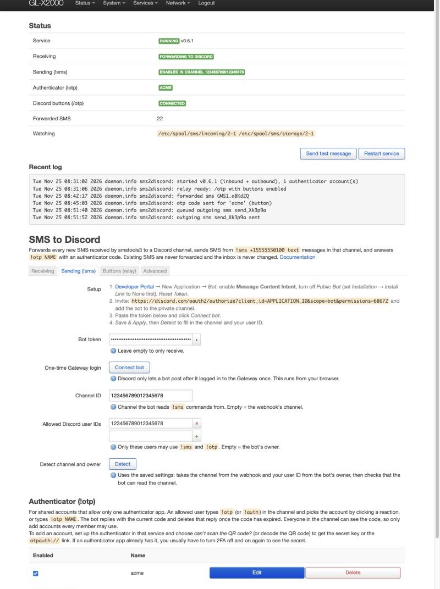

<p align="center"></p>

# sms2discord

**Shared 2FA codes for your team, in Discord.** A router with a SIM card forwards every SMS (OTP codes included) to a Discord channel, and acts as the team's authenticator app for accounts that allow only one: type `/otp`, click the account, get the code.

Runs **on the router itself**: OpenWrt routers with a cellular modem and `smstools3`, tested on a **GL.iNet GL-X2000 (Spitz Plus)** with firmware 4.7.

**SMS codes**
- Every new SMS appears in a Discord channel within seconds; the existing inbox is never forwarded
- `!sms +15555550100 hello` in the channel sends an SMS back, with ⏳ → ✅/❌ status reactions
- No duplicates, also after a reboot; retries while the internet is down

**Authenticator (TOTP / MFA) codes**
- For shared accounts that allow only one authenticator app: add the secret once in LuCI, then anyone on the allow-list can get the current code
- `/otp` shows a button per account and only the person who clicks sees the code (needs the optional [Cloudflare relay](#discord-buttons-optional)); `!otp` works without it and deletes the code once it has expired
- RFC 6238 TOTP in pure Lua, checked against the RFC test vectors; secrets never leave the router

**Security and footprint**
- Pure Lua + curl (~40 KB), no server needed, no Docker, no e-mail relay
- LuCI page to set it up and watch it (status, log, test button)
- Only allow-listed Discord users can send SMS or get codes; mentions disabled, markdown escaped, link previews off
- Secrets stay in `/etc/config/sms2discord` (`chmod 600`) and never appear in logs or on a command line. Logs never contain SMS text, phone numbers or codes.

```
modem ─▶ smsd ─▶ /etc/spool/sms/incoming/…   sms2discord polls every 2 s ─▶ Discord webhook ─▶ #sms
                                                                                                │ !sms +1555… text
modem ◀─ smsd ◀─ /etc/spool/sms/outgoing/…   sms2discord polls every 4 s ◀─ Discord bot (REST) ◀┘
```

```
/otp ─▶ Discord ─▶ relay (Cloudflare Worker, optional) ◀─ router polls every 2 s
                                                         └─▶ asks Discord who clicked, answers with the code
```

The router never needs inbound access: it only makes outgoing HTTPS requests to Discord (and the relay).

---

## Compatibility

sms2discord reads and writes the **smstools3** spool, so it works on any router where smstools3 handles the modem's SMS:

| Router / firmware | Status |
|---|---|
| GL.iNet GL-X2000 (Spitz Plus), firmware 4.7.13 and 4.7.14 | **Works**, tested daily. GL.iNet ships smstools3 for its SMS features. |
| Other GL.iNet 4.x routers with a cellular modem (X3000, XE3000, …) | Should work if their firmware also uses smstools3 (`ls /etc/spool/sms` shows it). Not tested. |
| OpenWrt 19.07 – 24.10 with smstools3 set up for the modem | Should work (opkg feed). Not tested on real hardware beyond GL.iNet. |
| OpenWrt 25.12 and newer (apk) with smstools3 | Should work (apk feed, installs cleanly in an OpenWrt 25.12 test system). Not tested on real hardware. |
| Routers that handle SMS with ModemManager (`mmcli`), `sms-tool` or the vendor's own daemon | **Not supported.** SMS never reach the smstools3 spool. |

Authenticator codes (`!otp`, `/otp`) only need the Discord bot, not the modem, so they work on any OpenWrt router.

## Requirements

- OpenWrt 19.07 or newer, or GL.iNet firmware 4.x, with a modem and **smstools3** receiving SMS
- `lua`, `lua-cjson`, `libuci-lua`, `curl` (pre-installed on GL.iNet 4.x; the package manager pulls them in otherwise)
- For the web UI: LuCI. On GL.iNet: **System → Advanced Settings → Install Now**, LuCI then runs on port 8080.

## Install

Two packages, both architecture-independent: `sms2discord` (the service) and `luci-app-sms2discord` (the web UI, optional). They are published in two feeds on GitHub Pages, one per package manager:

| Package manager | Feed |
|---|---|
| `opkg` (OpenWrt ≤ 24.10, GL.iNet 4.x) | `https://koraysels.github.io/sms2discord/packages` |
| `apk` (OpenWrt 25.12+) | `https://koraysels.github.io/sms2discord/apk/packages.adb`, signed with [`sms2discord.pem`](https://koraysels.github.io/sms2discord/apk/sms2discord.pem) |

### Option A: GL.iNet Plug-ins page (easiest)

1. **Applications → Plug-ins → Manage Sources**
2. Name `sms2discord`, URL `https://koraysels.github.io/sms2discord/packages`, click **+**, then **Apply**
3. **Refresh**, search `sms2discord`, install `sms2discord`, then `luci-app-sms2discord`

The same feed works on stock OpenWrt: add `src/gz sms2discord https://koraysels.github.io/sms2discord/packages` to `/etc/opkg/customfeeds.conf`, then `opkg update && opkg install sms2discord luci-app-sms2discord`. The feed is unsigned. If your opkg has `option check_signature` enabled, use option B instead.

### Option A2: OpenWrt 25.12+ (apk)

```bash
wget -O /etc/apk/keys/sms2discord.pem https://koraysels.github.io/sms2discord/apk/sms2discord.pem
echo https://koraysels.github.io/sms2discord/apk/packages.adb >> /etc/apk/repositories.d/customfeeds.list
apk update && apk add sms2discord luci-app-sms2discord
```

The key makes apk check the feed's signature; updates then come with `apk upgrade`.

### Option B: download the packages

On the router:

```bash
cd /tmp
base=https://github.com/koraysels/sms2discord/releases/latest/download
wget "$base/sms2discord_all.ipk" "$base/luci-app-sms2discord_all.ipk"
opkg update && opkg install ./sms2discord_all.ipk ./luci-app-sms2discord_all.ipk
```

On GL.iNet they then also show up under **Applications → Plug-ins**.

### Option C: from a clone, over SSH

```bash
git clone https://github.com/koraysels/sms2discord.git && cd sms2discord
HOST=root@192.168.8.1 ./install.sh          # --no-luci, --keep-on-upgrade
```

Builds both packages locally and installs them with opkg (one password prompt).

### Option D: in your own firmware

`package/` is a regular OpenWrt feed:

```bash
echo "src-git sms2discord https://github.com/koraysels/sms2discord.git" >> feeds.conf
./scripts/feeds update sms2discord && ./scripts/feeds install sms2discord luci-app-sms2discord
make package/sms2discord/compile package/luci-app-sms2discord/compile
```

## Configure

### In LuCI: Services → SMS to Discord



The page shows live status and the log and has a *Send test message* button.

1. **Receiving:** in Discord, open your private channel → *Edit Channel → Integrations → Webhooks → New Webhook → Copy Webhook URL*. Paste it, then *Save & Apply*. Send an SMS to the router to test it.
2. **Sending (optional):** create a dedicated bot:
   1. [Developer Portal](https://discord.com/developers/applications) → *New Application*
   2. *Bot*: enable **Message Content Intent** and *Reset Token*. Under *Installation*, set *Install Link* to **None**, then turn off *Public Bot*.
   3. Invite it with `https://discord.com/oauth2/authorize?client_id=<APPLICATION_ID>&scope=bot&permissions=68672` (View Channels, Send Messages, Read Message History, Add Reactions), then add it to the private channel under *Edit Channel → Permissions*.
   4. On the *Sending* tab: paste the token and click **Connect bot**. This is Discord's one-time Gateway login, required before a bot may post over REST, and it runs from your browser. Then *Save & Apply*.
   5. Click **Detect**: it takes the channel from the webhook, allows the bot's owner (you) as sender, and checks that the bot can read the channel.

### In a terminal

```bash
ssh -t root@192.168.8.1 sms2discord setup            # prompts, secrets are typed hidden
HOST=root@192.168.8.1 tools/setup-bot.sh             # bot only, from your computer (Node 22+)
```

## Use

```
!sms +15555550100 your message
```

| Reaction | Meaning |
|----------|---------|
| ⏳ | queued on the router |
| ✅ | sent by the modem |
| ❌ | sending failed |
| ⚠️ | no result after 15 minutes |
| 🚫 | you are not in `ALLOWED_USER_IDS` |

Numbers with country code (`+15555550100`) or national format, no spaces. Max 459 characters (3 SMS parts), max 10 SMS per hour by default.

Everyone who can read the channel can read your OTP codes. Keep it private.

### Authenticator codes

For accounts your team shares that allow only one authenticator app. Add each account once in LuCI (**Services → SMS to Discord → Authenticator → Add account**) with a short name and its secret key or `otpauth://totp/…` link. To get the secret, choose *can't scan the QR code?* while setting up 2FA in that service. If the account already uses an authenticator app, you usually have to turn 2FA off and on again to see the secret. Then, in the channel, type `!otp` (or `!auth`) and click the reaction for the account:

```
🔐 Pick an account:
1️⃣ billit
2️⃣ meta
closes in 60 s                [1️⃣] [2️⃣]
```

```
🔐 meta  123456  valid 18 s
deletes itself in 33 s
```

Or skip the menu with `!otp meta`. With only one account set up, `!otp` gives its code right away.

- Only allow-listed users can ask for a code or pick from the menu.
- The menu shows up to 20 accounts and closes after 60 s; a pick shows up within one Discord check (4 s by default). Discord buttons would need a public endpoint, which a router doesn't have, so reactions do the job.
- With less than 10 s left, the reply also shows the next code.
- The bot deletes its reply 15 s after the code expires. The secret never goes through Discord, and codes are never logged.
- SHA1 only (what nearly every service uses), 6–8 digits, any period.
- Codes depend on the router clock; if NTP has not synced yet, the bot refuses instead of giving wrong codes.

### Discord buttons (optional)

The menu above uses reactions because a router can't receive Discord's button clicks: it has no public address. A tiny Cloudflare Worker (free plan) in [`relay/`](relay/) fixes that:

- `/otp` (or `/auth`) shows a row of buttons, one per account; a click shows that account's code
- only the person who clicks sees the code (an ephemeral reply), so nothing needs deleting and the channel stays clean
- the code turns into "expired" once it is no longer valid

The Worker holds **no authenticator secrets**, only the account names and the bot's public key. For every click the router asks Discord itself who clicked, checks that person against the allow-list, computes the code and answers the click directly. A compromised Worker can stop the buttons from working, but it can't get codes.

Setup, once. Either click

[](https://deploy.workers.cloudflare.com/?url=https://github.com/koraysels/sms2discord/tree/main/relay)

and fill in `RELAY_KEY` (32+ letters and digits, e.g. from `openssl rand -hex 32`), or from a clone:

```bash
cd relay
npx wrangler login
npx wrangler deploy                 # prints https://sms2discord-relay.<you>.workers.dev
openssl rand -hex 32 | tee .relay-key | npx wrangler secret put RELAY_KEY
```

Then in LuCI → **Buttons (relay)**: paste the Worker URL and the key from `relay/.relay-key`, and Save & Apply. The router registers `/otp` and `/auth` in your server and sets the bot's *Interactions Endpoint URL* by itself; the status shows **Discord buttons: Connected**. The router checks the Worker every 2 s (about 43,000 requests a day, within the free plan's 100,000).

`!otp` in the channel keeps working, with or without the relay.

Anyone who can read the channel and knows the password can log in, so turn on 2FA for the Discord accounts in that channel. Some services forbid sharing an account in their terms; that is your call.

## Manage (on the router)

| What | Command |
|------|---------|
| Status and recent log | `sms2discord status` (`--json` for scripts) |
| Send a test message | `sms2discord test` |
| Follow the log | `logread -f -e sms2discord` |
| Restart / stop / disable | `/etc/init.d/sms2discord restart` / `stop` / `disable` |
| Change settings | LuCI, `sms2discord setup`, or `uci` + `/etc/init.d/sms2discord restart` |
| Fill in channel and owner | `sms2discord detect` |
| Current code, locally | `sms2discord otp NAME` |
| Built-in tests | `sms2discord selftest` |

Config: UCI `/etc/config/sms2discord` (`chmod 600`, kept on package upgrades), section `main`:

| Option | Default | Meaning |
|--------|---------|---------|
| `enabled` | `1` | Start the service |
| `webhook_url` | | Discord webhook for incoming SMS |
| `bot_token` | empty | Bot token; empty disables `!sms` |
| `channel_id` | webhook's channel | Channel the bot reads |
| `allowed_user` (list) | bot owner | Discord user IDs allowed to send |
| `poll_sms` | `2` | Seconds between inbox checks |
| `poll_discord` | `4` | Seconds between Discord checks |
| `out_max_per_hour` | `10` | Outgoing SMS limit |
| `relay_url` | empty | Cloudflare Worker for `/otp` buttons; empty = off |
| `relay_key` | empty | Shared secret with the Worker (`RELAY_KEY`) |

Authenticator accounts are `otp` sections:

```
config otp
	option name 'meta'
	option secret 'otpauth://totp/Meta:team?secret=JBSWY3DPEHPK3PXP'
	option enabled '1'
```

State lives in `/etc/sms2discord/`: `seen` (forwarded files) and `last_id` (last Discord message handled). Configs from v0.1/v0.2 (`/etc/sms2discord/config`) are migrated automatically.

`/etc/config` is part of router backups, so a backup contains your webhook URL, bot token, relay key and authenticator secrets. Keep backups private.

## Uninstall

```bash
opkg remove luci-app-sms2discord sms2discord          # on the router
HOST=root@192.168.8.1 ./uninstall.sh [--purge]        # or from a clone; --purge deletes config and secrets
```

The SMS inbox is never touched. Delete the webhook and bot in Discord afterwards.

## How it works

- smstools3 writes each received SMS as a file. sms2discord reads the spool directories from the live smstools config (`/tmp/smstools.cfg` on GL.iNet, `/etc/smsd.conf` on stock OpenWrt) and polls them. It does not use smstools' `eventhandler`, because GL.iNet regenerates that config at every start and its own forward script would be overwritten on updates.
- GL.iNet's `modem_AT` also stores received SMS in `storage/<bus>`; that directory is watched too when it exists.
- `Alphabet: ISO` bodies are ISO-8859-15, `UCS2` bodies are raw UTF-16BE. Both are converted to UTF-8.
- On first start every existing file counts as seen. A file is forwarded once its size is stable across two polls, and only marked seen after Discord confirms it.
- Outgoing SMS use the same spool format as smstools' `sendsms`, written atomically. smstools moves them to `sent/` or `failed/`, which drives the status reactions.
- Discord is polled over REST, so there is no long-lived Gateway connection. Snowflake IDs are compared as strings because Lua 5.1 numbers can't hold them.

## Development

```
package/sms2discord/files/sms2discord.lua   daemon + CLI                       → /usr/bin/sms2discord
package/sms2discord/files/sms2discord.init  procd service, restarts on config change → /etc/init.d/sms2discord
package/sms2discord/files/sms2discord.config default UCI config               → /etc/config/sms2discord
package/luci-app-sms2discord/               LuCI view, menu entry, rpcd ACL
tools/build-ipk.sh                          build both dist/*.ipk without the SDK
tools/setup-bot.sh                          connect the bot (token stays local)
tools/gateway-identify.mjs                  one-time Gateway login
install.sh / uninstall.sh                   copy-based install over SSH
```

Run the tests on a router: `ssh root@192.168.8.1 'lua - selftest' < package/sms2discord/files/sms2discord.lua`

Releases: push a tag `v<version>` matching `PKG_VERSION` and GitHub Actions attaches both `.ipk` files (versioned, plus `*_all.ipk` aliases for `releases/latest/download`).

## License

MIT
